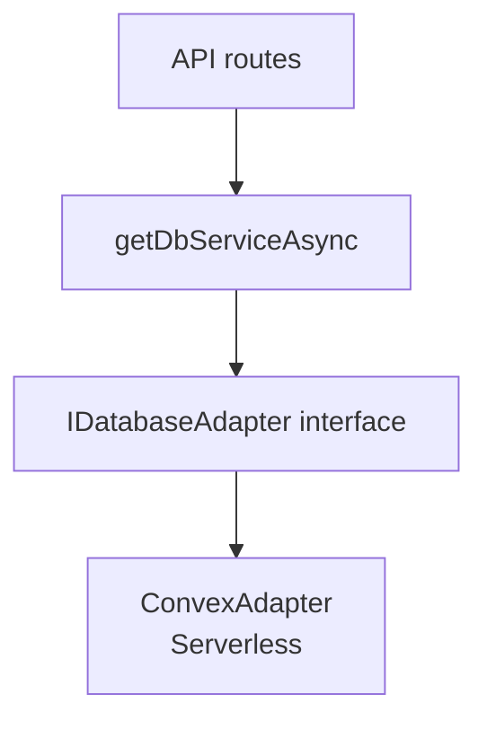

# Database

SmartFall stores its data in Convex, a serverless backend. All database access goes through a single adapter interface.

## Database Overview

The system manages 12 core entities with relationships:

- **Users** - Authentication and account data
- **Sessions** - User login sessions
- **Patients** - Patient profiles
- **Caregivers** - Caregiver profiles
- **CaregiverPatients** - Caregiver-patient relationships
- **Falls** - Fall event records
- **Devices** - IoT device information
- **SensorData** - Time-series sensor readings
- **DeviceStatus** - Device status snapshots
- **DeviceLogs** - Device activity logs
- **HealthLogs** - Patient vital monitoring
- **Messages** - Inter-user messaging

## Database Selection

Configure the Convex deployment with environment variables:

```bash
CONVEX_DEPLOYMENT=prod:your-deployment-id
NEXT_PUBLIC_CONVEX_URL=https://your-deployment-id.convex.cloud
```

## Sections

### Schema Overview

Entity relationship diagram and schema structure

### Database Models

Detailed model definitions with all fields

## Data Flow



## Key Design Patterns

### Repository Pattern

Each model has a dedicated repository:

- `db.users.create()`, `findById()`, `update()`, `delete()`
- `db.patients.list()`, `findByUserId()`
- `db.falls.create()`, `getByStatus()`

### Timestamp Tracking

All entities include:

- `createdAt` - Record creation
- `updatedAt` - Last modification
- Some include `deletedAt` for soft deletes

### User Association

Most entities track their owning user:

- `userId` - Foreign key to User
- Enables cascading authorization

## Query Examples

### Find Patient Falls (Last 7 Days)

```typescript
const db = await getDbServiceAsync();
const falls = await db.falls.findByUserId(patientId, {
  since: new Date(Date.now() - 7 * 24 * 60 * 60 * 1000),
});
```

### Create Sensor Data

```typescript
const db = await getDbServiceAsync();
const record = await db.sensorData.create({
  deviceId: "device-uuid",
  accelX: 0.5,
  accelY: 0.3,
  accelZ: 9.8,
  // ... other fields
});
```

### List High-Risk Patients

```typescript
const db = await getDbServiceAsync();
const highRisk = await db.patients.findByRiskLevel(75);
// isHighRisk = riskScore >= 75
```

## Transactions

### Convex Transactions

```typescript
export const createFallWithAlert = mutation({
  args: {
    /* ... */
  },
  handler: async (ctx, args) => {
    const fall = await ctx.db.insert("falls", args);
    const alert = await ctx.db.insert("alerts", {
      /* ... */
    });
    return { fall, alert };
  },
});
```

## Indexing Strategy

### Convex Indexing

Indexes automatically created for:

- Foreign key references
- Frequently filtered fields

## Backup & Recovery

### Convex

- Automatic daily backups
- Version history maintained
- Automatic recovery on failure

## Performance Considerations

### Convex

- **Pros**: Serverless, automatic scaling, real-time subscriptions
- **Cons**: Limited offline capabilities
- **Best for**: Cloud-first, auto-scaling requirements

## Related Documentation

- [API Reference](/docs/api-reference)
- [Getting Started](/docs/getting-started)
